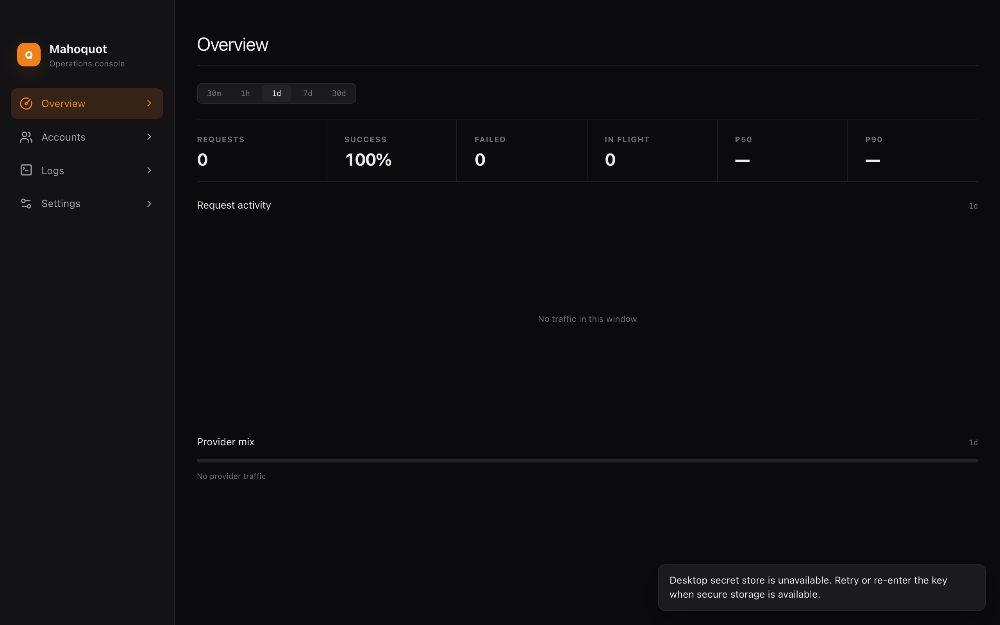
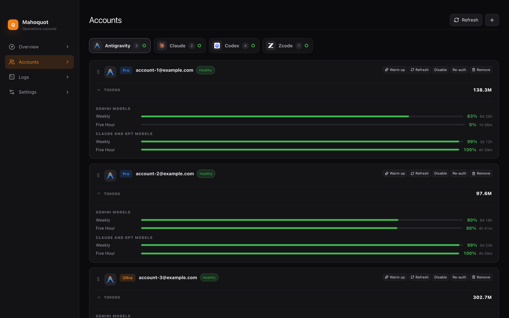
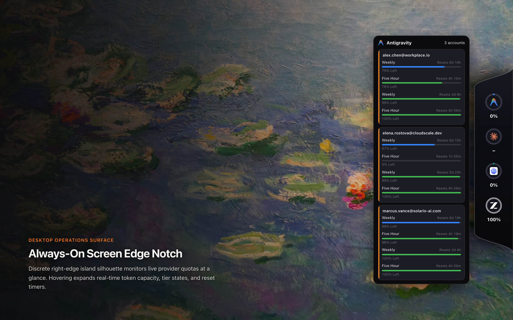

<p align="center">
  
</p>

<h1 align="center">Mahoquot</h1>

<p align="center">
  High-concurrency LLM inference proxy and account router written in Rust with an operations console.
</p>

<p align="center">
  <a href="./AGENTS.md">Architecture</a> &bull;
  <a href="./PRODUCT.md">Product Contract</a> &bull;
  <a href="./DESIGN.md">Design Tokens</a> &bull;
  <a href="./docs/CONTRACTS.md">Protocol Contracts</a> &bull;
  <a href="./docs/reference-parity.md">Provider Reference</a>
</p>

---

## Overview

Mahoquot routes inference traffic across subscription pools for Codex, Claude, Gemini, Antigravity, Cursor, Kiro, and Z-code. It distributes requests across upstream accounts with monotonic round-robin fairness, automatic OAuth token refreshing, pre-first-byte in-flight failover, and lock-free runtime configuration. It provides a drop-in replacement for the CLIProxyAPI management surface (129 routes).

<p align="center">
  
</p>

<p align="center">
  
</p>

A right-edge notch keeps per-provider quota on screen without opening the console. Hovering expands the island into per-account limits and reset times.

<p align="center">
  
</p>

---

## Core Capabilities

- **Sequence-stamped round robin**: Monotonic rotation that survives account churn, cooldown, and recovery without double-serving or counter resets.
- **Pre-first-byte failover**: Automatic retries across up to `min(pool_available, 3)` distinct accounts on 429, 401, 403, 500, 502, 503, and 504 before any downstream byte is committed.
- **Zero-copy passthrough**: No body parsing on matched-family routes. Pooled hyper client per upstream host with `TCP_NODELAY`.
- **Lock-free configuration**: `ArcSwap` on the request hot path. Settings persist atomically to YAML with zero downtime and no restart needed.
- **Automatic OAuth refresh**: Credentials live as OAuth account files on disk; expired tokens refresh automatically in the background.

---

## Desktop Application

The desktop application bundles the gateway as a managed native process.

### Quick Start

1. **Clone the repository**:
   ```bash
   git clone --recurse-submodules https://github.com/Indosaram/mahoquot.git
   cd mahoquot
   ```
   *(If cloned without `--recurse-submodules`, the build process automatically initializes and fetches the `mahoquot-proxy` submodule.)*

2. **Run in development**:
   ```bash
   bun install
   bun run dev
   ```
   Or launch directly via Cargo:
   ```bash
   cargo run -p mahoquot-monitor-ui
   ```

3. **Build production app bundle**:
   ```bash
   bun install
   bun run build
   ```
   Generated native packages are placed under `target/release/bundle/`:
   - macOS: `.app`, `.dmg`
   - Linux: `.deb`, `.rpm`
   - Windows: `.exe` (NSIS setup), `.msi` (WiX)

---

## Standalone Proxy

The proxy core can run headless without the desktop UI. It is maintained in [`mahoquot-proxy`](https://github.com/Indosaram/mahoquot-proxy) (submodule at `./mahoquot-proxy` or sibling checkout `../mahoquot-proxy`).

```bash
cd mahoquot-proxy
cargo build --release --bin mahoquot-gateway
./target/release/mahoquot-gateway serve --auth-dir ~/.mahoquot/auth
```

---

## Verification

Run the aggregate source/build/browser gate from the desktop repository root:

```bash
bash scripts/verify.sh
```

Provision prerequisites separately: Rust with rustfmt/clippy and cached Cargo dependencies,
Bun, Node, Python 3, minisign (and codesign on macOS), the pinned proxy submodule,
locked frontend/site dependencies, and each package's Playwright Chromium plus system
libraries. The gate does not install dependencies or browsers. Pre-stage both reviewed
target-named gateway and captcha-solver sidecars in `crates/monitor-ui/gateways/`, then
set `MAHOQUOT_SKIP_GATEWAY_BUILD=1`. Run full Rust suites only in a reviewed disposable
user/VM with `MAHOQUOT_VERIFY_DISPOSABLE=1`; this acknowledgement is not isolation proof.
Use an owned temporary/cache root and free fixture ports in 18840-18899 (desktop 18847,
site 18848). Never reuse live credentials or provider endpoints.

Gates executed once per invocation:
- Gateway and desktop Rust formatting, clippy and workspace tests
- Script contracts, updater signature fixtures, proxy/solver selection fixtures,
  evidence-harness negatives and QA case/orchestration regressions
- Frontend typecheck, lint, fresh bundle and unit tests (including artifact contracts)
- Site typecheck/build, component regressions and Chromium browser contracts
- Desktop browser contracts and embedded console freshness/drift across repositories

`bash scripts/verify.sh --scripts` runs only the script contract suites (also wired into
CI). These include local subprocess/build fixtures, not just static checks. The full
gate rebuilds the checked-in console and fails on stale output; review regenerated bytes
before committing. Existing failing contracts remain failures, not skipped coverage.
Do not run focused suites and then the aggregate merely to obtain duplicate receipts.
CI browser jobs provision their browsers explicitly and run independently.

This is not native GUI, installed-updater, Windows/Linux packaging, live-provider or
performance certification. Synthetic receipts cannot certify real behavior. Native
parity currently fails closed; K1 shared-login keychain safety remains unresolved and
requires a disposable macOS user/VM, not merely a different HOME. Historical QA
producers and real desktop-parity are not invoked by this gate.

---

## Benchmarks

The historical results below come from [`results/FAIR-TRANSLATION-BENCH.md`](./results/FAIR-TRANSLATION-BENCH.md): paired within-round comparison, randomized tier order, warmup round discarded, deterministic mock upstream with a 40 ms TTFT floor, measured on Apple M4 Max (macOS arm64). They are not measurements of the current checkout. The earlier architecture comparison used unequal translation workloads and is superseded for performance comparisons.

- **Tier A**: Direct mock (floor)
- **Tier B**: CLIProxyAPI v7.2.140 (Go incumbent)
- **Tier C**: mahoquot-gateway (Rust)

### Protocol Translation Performance

Workload: Two-way translation between OpenAI and Codex responses at 500 concurrent streams across 6 kept rounds (median values). Full details: [`results/FAIR-TRANSLATION-BENCH.md`](./results/FAIR-TRANSLATION-BENCH.md).

| Load Point | Tier | p50 TTFT (ms) | p99 TTFT (ms) | Throughput (RPS) |
|---|---|---|---|---|
| 20 chunks | A (Direct) | 42.1 | 83.3 | 9,004 |
| 20 chunks | B (CLIProxyAPI) | 54.1 | 130.7 | 6,998 |
| 20 chunks | C (mahoquot-gateway) | 44.1 | 78.4 | 8,622 |
| 200 chunks | A (Direct) | 43.7 | 94.3 | 8,697 |
| 200 chunks | B (CLIProxyAPI) | 107.7 | 467.0 | 1,314 |
| 200 chunks | C (mahoquot-gateway) | 57.2 | 139.1 | 4,747 |

At 20 chunks, mahoquot delivers +10.5 ms p50 / +43.7 ms p99 improvements. At 200 chunks, advantages scale to +49.8 ms p50 / +311.8 ms p99 over the Go incumbent.

### Long Streaming Throughput

For the same paired translation run's 200-chunk workload at 500 concurrent streams,
median throughput was **4,746.5 RPS** for Tier C and **1,314.3 RPS** for Tier B
(rounded to 4,747 and 1,314 in the table). Raw runs are referenced at
`results/fair-translation-runs/` in the report. The report also records two Tier C
client timeouts across 112,000 requests, including one kept-round timeout; these
results must not be described as error-free. No new benchmark was run for this documentation.

### Reproducing Benchmarks

The benchmark package is `mahoquot-proxy/tools/bench/Cargo.toml`, not a member of
the desktop workspace. The following is a **single-tier mock smoke example**, not
reproduction of the paired table. From the desktop repository root:

```bash
cd mahoquot-proxy
cargo build --release -p bench --target-dir target

# 1. Deterministic mock upstream (40 ms TTFT floor, 20 SSE chunks)
target/release/bench mock --port 18850 --ttft-ms 40 --chunks 20

# 2. In a second terminal, also in mahoquot-proxy (mock remains running)
target/release/bench run --url http://127.0.0.1:18850/v1/chat/completions \
  --out /tmp/mahoquot-bench-owned/direct.json \
  --concurrency 500 --total 2000 --timeout-ms 15000
```
Create an owned output directory first and stop only your mock afterward. To reproduce
the table, provision both proxy tiers with disposable credentials and explicit mock
upstream overrides, use the same Codex translation workload, randomize tier order per
round, discard warmup, and retain six paired rounds plus errors and source/binary
identities as described in the linked report. Do not direct these commands at live
providers. Use ports in the 18840-18899 range for isolated testing.
